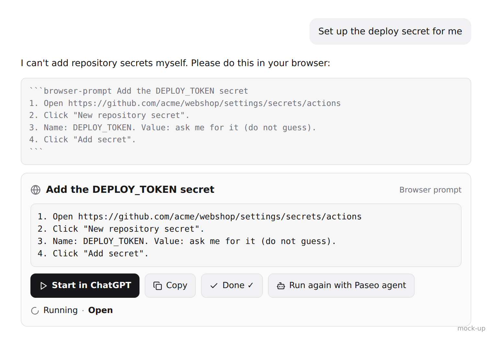

# Browser prompt for Paseo

A [Paseo](https://paseo.sh) plugin that renders a card with **Start in ChatGPT**, **Copy**, **Done**
and **Run with Paseo agent** for every `browser-prompt` block in an assistant message.



See [OVERVIEW.md](OVERVIEW.md) for what it does, what data goes where, and its limits, and
[SECURITY.md](SECURITY.md) for reporting vulnerabilities.

## Install

From the Paseo plugin registry, once listed:

```bash
paseo plugin add midego1/browser-prompt
```

Directly from Git:

```bash
paseo plugin add git:midego1/paseo-browser-prompt
# pin a branch, tag or commit
paseo plugin add git:midego1/paseo-browser-prompt --ref main
```

The plugin updates itself from the repository you installed it from; turn off 'Auto-update on use'
in settings to pin a version.

`paseo plugin add` and `paseo plugin install` are aliases. The plugin has no runtime npm
dependencies and no build step. Tailscale on the daemon host is needed only for the ChatGPT desktop
app launcher; everything else works without it.

## Convention for agents

When the human must do something in a browser, write a fenced code block with the
info string `browser-prompt`, optionally followed by a short title on the same line:

````markdown
```browser-prompt Add the DEPLOY_TOKEN secret
1. Open https://github.com/acme/webshop/settings/secrets/actions
2. Click "New repository secret".
3. Name: DEPLOY_TOKEN. Value: ask me for it (do not guess).
4. Click "Add secret".
```
````

Rules:

- One block per independent task; several blocks per message are fine.
- Number the steps and include full URLs.
- Refer to secrets by name only. Never put a secret value in the block.
- Close the fence. The card appears only once the closing fence is written.
- Blocks inside another code block (for example a ````markdown example) are ignored.

## Safe defaults

- The ChatGPT launcher binds only to this machine's own Tailscale address (100.64.0.0/10) or, when
  set explicitly, 127.0.0.1. Wildcards, LAN, public addresses and host names are refused; without a
  usable address the launcher stays off and Start in ChatGPT only copies.
- Launcher links carry a random one-time id (18 bytes), expire after 10 minutes and are deleted on
  first fetch. The prompt is never in the launcher URL, and prompt text is never logged.
- ChatGPT web mode puts the prompt in the `chatgpt.com` URL only when it is short and has nothing
  that looks like a credential.
- Run with Paseo agent starts agents only in ask-first permission modes and always prepends the
  fixed safety preamble.
- Links in rendered messages open only when they are http(s) URLs; the ChatGPT app deep link may
  use only the `codex:` or `https:` scheme.
- No telemetry. Self-update only from the `https://` remote the plugin was installed from, and only
  as a fast-forward of the installed commit on the tracked branch.

## Development

```bash
npm ci
npm run typecheck
npm test                     # parser, launcher, updater and agent-prompt unit tests
paseo plugin install "$PWD"  # first time
paseo plugin reload browser-prompt
paseo plugin logs browser-prompt
```

Dependencies are pinned to exact versions and locked in `package-lock.json`. They are all
development or host-provided modules (Paseo supplies `@getpaseo/plugin`, React, React Native,
TanStack Query and zod at runtime).

## Internals

Layout: `shared/browser-prompt.ts` (pure parser, transformer output, URL plan, deep link
and trampoline page), `shared/settings.ts` (host settings), `shared/trampoline.ts` (stash
RPC), `server/trampoline.ts` + `server/launcher.ts` (one-time launcher on this machine's Tailscale
IP, port 5299), `client/` (card, markdown fallback, launch actions, settings screen, agent run), `shared/agent-prompt.ts`
(agent safety preamble, prompt builder, config defaults), `index.client.tsx`, `index.server.ts`.

Start in ChatGPT (desktop default): copy prompt, RPC stashes it under a one-time id
(10 min TTL, deleted on first fetch), Paseo opens `http://<tailscale-ip>:5299/open?id=...`,
the page does `location.replace("codex://new?prompt=...")`. Prompt text is never logged.
Check the bind with `ss -ltnp | grep 5299`.

Launcher address (`shared/trampoline-host.ts`, `server/launcher.ts`): the `trampolineHost` setting
(accepted only when it is 127.0.0.1 or a Tailscale address assigned to this machine, otherwise the
launcher stays off with `not-local`), else `tailscale ip -4` (3 s timeout), else a non-internal
address in 100.64.0.0/10 on a Tailscale interface (`tailscale*`, `utun*`), else none: the
listener is not started (never 0.0.0.0) and `trampoline.stash` returns
`{ unavailable: "no-tailscale" }`, so the client copies and shows "ChatGPT launcher needs Tailscale
on this host". `trampolinePort` defaults to 5299; EADDRINUSE reports `port-in-use`. Host or port
changes restart the listener. The client only uses the URL the server returns.

## Run with Paseo agent

The card's "Run with Paseo agent" button uses the app's own Paseo connection (`usePaseo()`):

- Workspace: `useAgent(cardAgentId, a => a.workspaceId)`; if the app has no snapshot yet,
  `paseo.agents.ref(id).refresh()`; last resort the most recently active workspace
  (`workspaces.list({ sort: activity_at desc, limit 1 })`).
- `paseo.workspaces.ref(workspaceId).agents.create({ config, title: "Browser: <title>", prompt })`
  with `config = { provider: "claude/claude-sonnet-5-5", modeId: "default", thinkingOptionId: "high" }`
  by default (host settings). Only ask-first modes are used (`ASK_FIRST_MODES`: claude `default`/`plan`,
  omp `ask`); other modes fall back to the ask-first mode and providers without one are refused.
- `prompt = buildAgentPrompt(title, steps)`: fixed safety preamble (`AGENT_SAFETY_PREAMBLE`)
  plus the steps verbatim inside `<steps>`.
- The card remembers `<agentId>:<cardId> -> startedAgentId` in host settings and shows the
  status from `useAgent(startedAgentId, …)`. Timeline renderers get no `navigation`, so
  "Open" opens the plugin screen `agent-run`, which calls `navigation.openAgent` once.
  Screens get no client-state provider on Paseo 0.11, so screen code must not use
  `useAgent`/`useWorkspace` (they throw "Plugin state hooks must run inside a workspace
  panel"); `test/screen-hooks.test.mjs` checks every registered screen's import graph.
- Nothing is appended to timelines and prompt text is never logged.

## Self-update on use

No cron. `update.check` (server RPC, `shared/update.ts`) is called by the card on its first render
in an app session and on Start, Copy and Run; the settings screen has Check now (`force: true`) and
reads `update.status`.

- Install info: `paseo plugin ls --json` (this plugin's `installation.identity.remote` and
  `currentRevision`). Non-Git installs report "Local install, no auto-update".
- Only `https://` remotes (the one the plugin was installed from); Git runs with
  `-c protocol.allow=never -c protocol.https.allow=always`, no terminal prompts.
- Latest: `git ls-remote --symref <remote> HEAD 'refs/heads/*'` (10 s timeout, no prompts).
  Paseo stores only the installed commit, not the ref, so the followed branch is inferred: the
  branch whose tip is the installed commit (previous choice, then default branch), else the
  previously followed branch, else the default branch. "Follow branch" in settings overrides it.
- Fast-forward only: a commit-only (`--filter=tree:0`) bare copy of the remote in
  `~/.local/state/paseo-plugin-browser-prompt/history.git` is fetched for the tracked branch and
  `git merge-base --is-ancestor <installed> <latest>` must succeed; otherwise the result is
  `not-fast-forward` and nothing is installed.
- Apply: detached `/bin/sh -c '"$1" plugin update "$2" --ref "$3" --yes; rm -f "$4"'` in its own
  session, output in `~/.local/state/paseo-plugin-browser-prompt/update.log`; the plugin's reload
  does not kill it, and the daemon is never restarted.
- Guards: in-process flag plus `update.lock` (O_EXCL, stale after 10 min); one remote check per
  30 minutes (in memory and in `state.json` next to the lock). Server code cannot write host
  settings in Paseo 0.11, so the toggles live in the `updates` settings document and the check
  state in that file.
- Logic and tests: `shared/updater.ts`, `test/updater.test.mjs`.

Switch an install to follow another branch: `paseo plugin update browser-prompt --ref <branch> --yes`
(the updater then follows that branch).
Update log: `~/.local/state/paseo-plugin-browser-prompt/update.log`.
